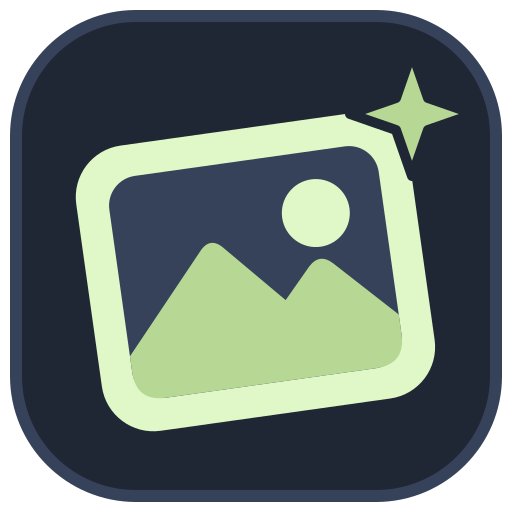
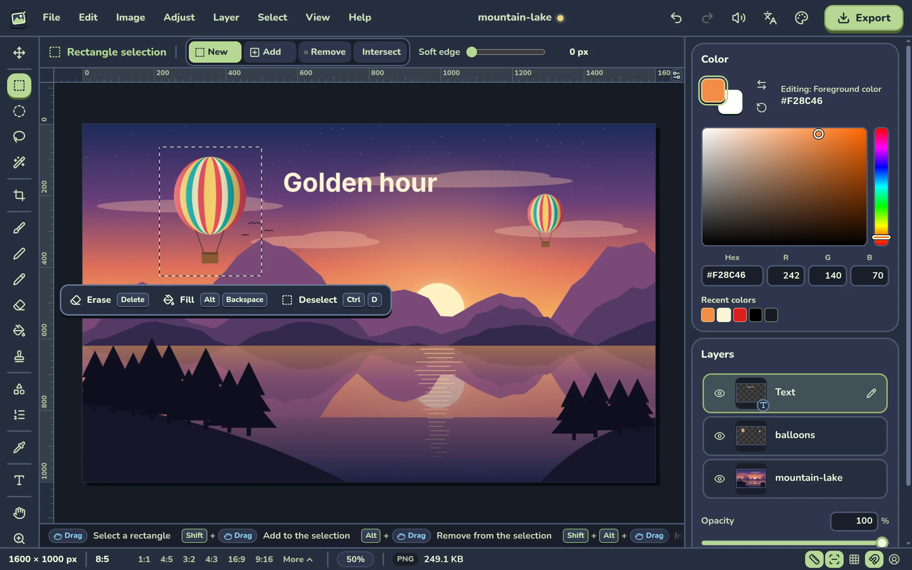
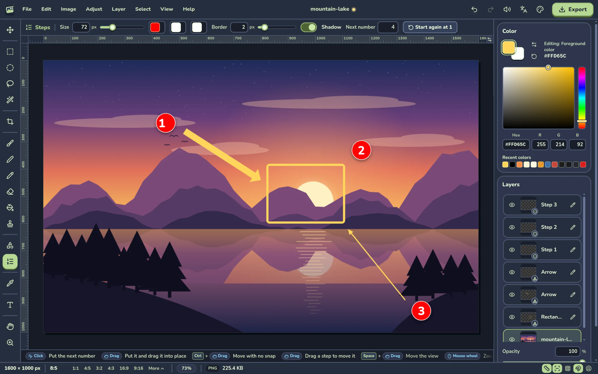
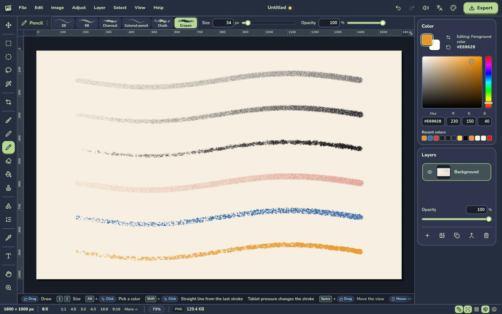
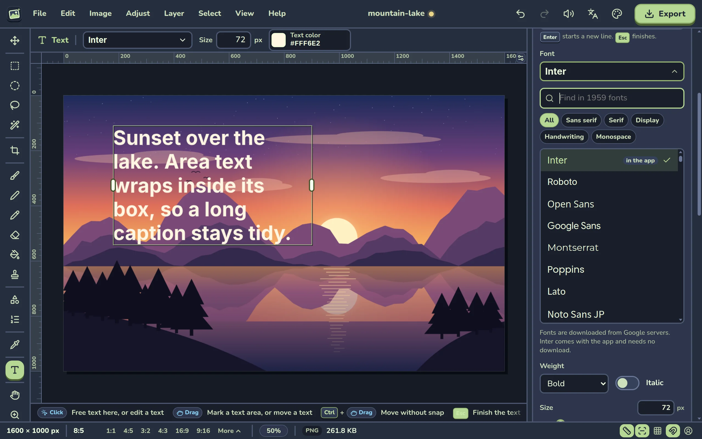
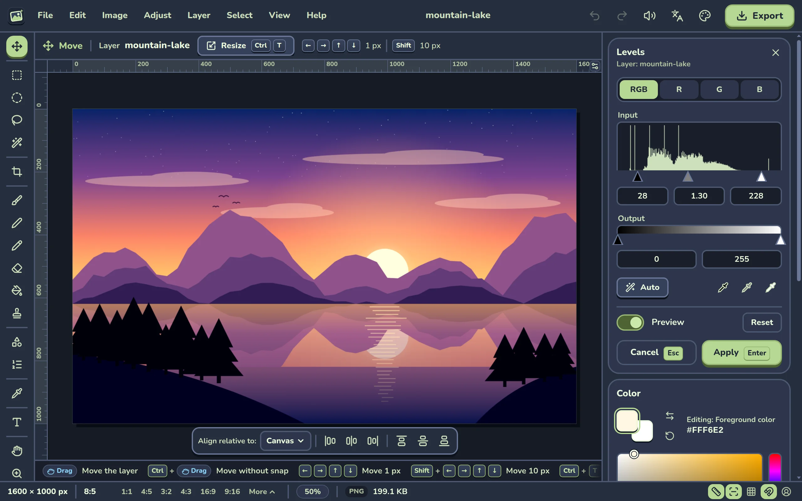
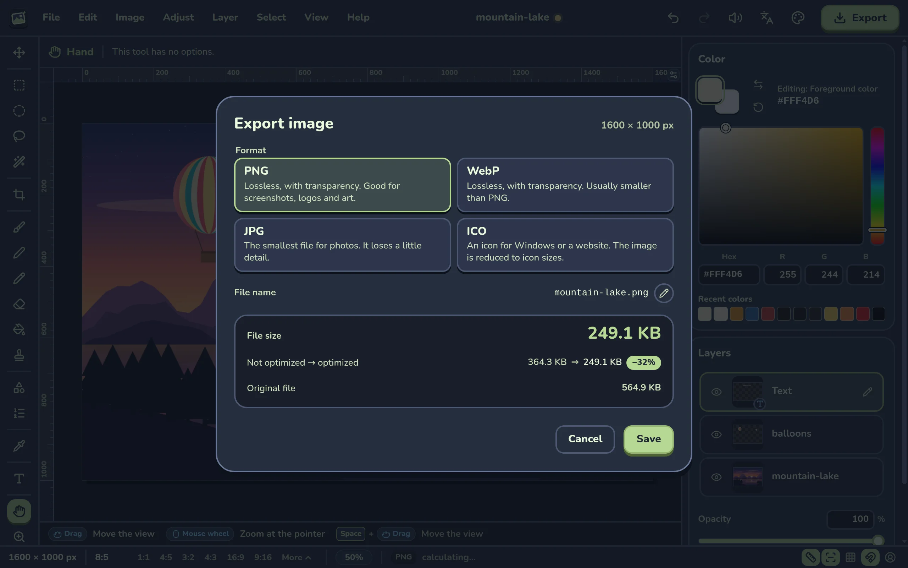
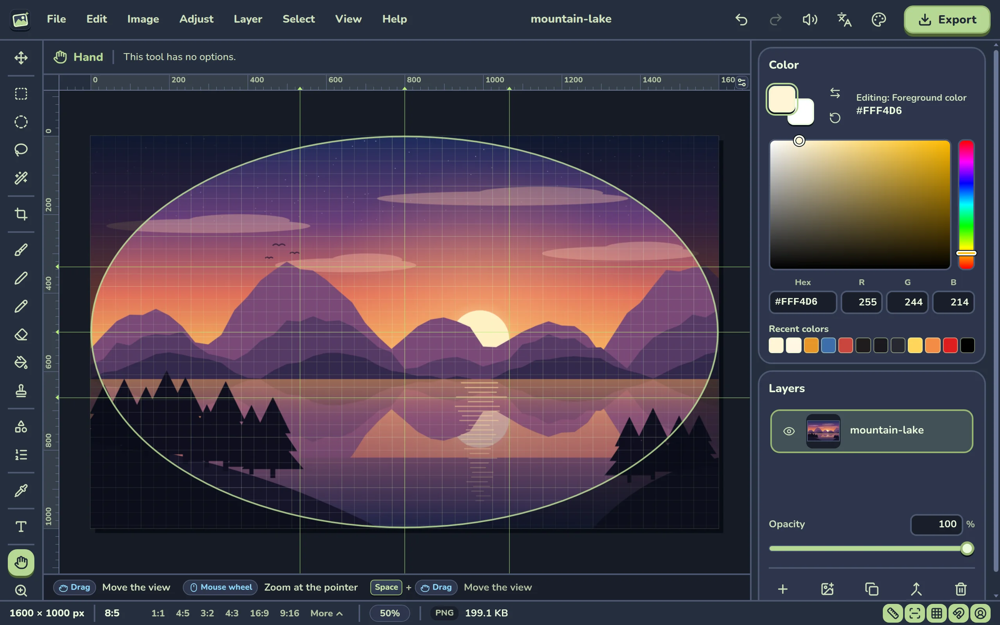
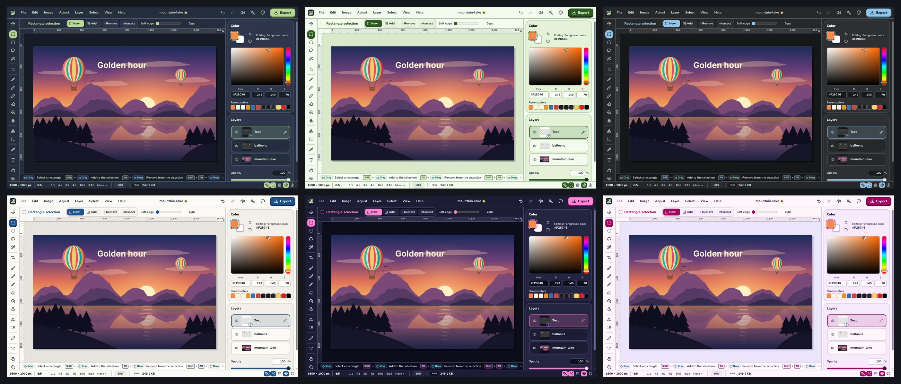

<p align="center">
  
</p>

<h1 align="center">Mini Image Editor</h1>

<p align="center"><strong>A small desktop image editor for quick edits: open an image, edit it, export it, close it.</strong></p>

> A free desktop app, made with Tauri 2, Svelte 5 and TypeScript. Your image stays on your computer.



## The app

- Use it when you must do a fast change to an image and do not want to learn a large editor.
- There is no project file. Open an image, edit it and export a new file.
- Edit with layers, selections, paint tools, shapes, numbered steps, adjustments and text.
- Export an optimized PNG, WebP, JPG or ICO, and see the file size before you save.
- Each action gives a short sound and a visual response.
- The interface is in English and in Brazilian Portuguese. By default, the app uses the language of your system. You can select a different language in the app.

## Gallery

| | |
|---|---|
|  |  |
| Shapes, arrows and numbered steps for a tutorial. | The six textures of the Pencil, from light to full pressure. |
|  |  |
| Area text and the Google Fonts picker. | Levels, with the histogram and a live preview. |
|  |  |
| The export dialog shows the file size before you save. | Rulers, guides, the grid and the avatar overlay. |



The six color themes.

## Contents

- [Gallery](#gallery)
- [Features](#features)
- [Keyboard shortcuts](#keyboard-shortcuts)
- [Mouse and modifier keys](#mouse-and-modifier-keys)
- [Export formats](#export-formats)
- [Privacy](#privacy)
- [Status](#status)
- [Development](#development)
- [Build for Windows](#build-for-windows)
- [Build for Linux (prepared, not tested)](#build-for-linux-prepared-not-tested)
- [Project structure](#project-structure)
- [License](#license)

## Features

### Image and canvas

- Open PNG, JPG, WebP, GIF and BMP files. Drop a file into the window, paste it, or use the open dialog.
- Make a new empty image. The dialog has the presets Square, Landscape, Story and Icon, a button that swaps the width and height, and a transparent, white or black background.
- Canvas size: set the new width and height in px or %, also relative to the current size. Select the anchor in a 3 x 3 grid and the fill: transparent, white, black, the foreground color or the background color.
- Crop tool with 8 handles. You can drag a handle out of the image to make the canvas larger. Push Enter to apply and Esc to cancel. The layers keep their pixels outside the canvas.
- The crop box is free, or you can lock its ratio. Press outside the box to draw a new box.
- Image size: set the width and height in px or %, with a chain lock. Select the resample method (Automatic, Smooth, Sharp, Pixel art) or a preset for the longest side (512 to 4096 px). The dialog shows the estimated file size before and after.
- Aspect ratio: the status bar shows the ratio of the image. Preset buttons (1:1, 4:5, 3:2, 4:3, 16:9, 9:16, and more in the "More" menu) open the crop tool with the largest centered box of that ratio. A switch selects crop or expand.
- Zoom with the mouse wheel at the pointer, with the zoom tool or with the keys. Click the zoom value in the status bar to select a zoom level.
- Move the view with Space and a drag, the middle mouse button or the hand tool.
- The status bar shows the size in px, the ratio, the zoom and the estimated export size.
- Undo and redo for each edit.
- A confirmation before close, open or new when the image has edits that you did not export.
- A warning when an image is larger than 25 megapixels.

### Selection and layers

- Rectangle, ellipse, lasso and magic wand selections. Use the mode buttons New, Add, Remove and Intersect, or the modifier keys.
- The magic wand has a tolerance, the "Connected area only" option and a soft edge. It reads only the pixels of the active layer, so the other layers do not limit the selection.
- On an empty layer, one click of the magic wand selects the full image.
- With a text or shape layer active, the magic wand reads the pixels of that layer. It does not add a layer.
- When the active layer is hidden, the magic wand shows "The active layer is hidden. Show the layer to select in it."
- Soft edge, select all, deselect and invert.
- A floating bar next to the selection erases it or fills it with the foreground color.
- The paint tools and the adjustments change only the pixels inside the selection.
- With the move tool, drag inside a selection to move its pixels to a new layer with the name "Cutout".
- Layers panel: thumbnail, visibility, opacity, rename, drag to reorder, new, duplicate, delete and merge down.
- A dropped, pasted or added image becomes a new layer. An image larger than the canvas is fitted inside it.
- Move tool: drag a layer, or push an arrow key to move it 1 px (10 px with Shift).
- Resize a layer with handles. The resize is proportional; hold Shift to resize freely.
- Align a layer to the canvas: left, center, right, top, middle or bottom. The alignment uses the visible pixels of the layer.

### Paint

- Pen (hard edge, pixel by pixel), brush (hardness and opacity) and eraser. The cursor shows the outline of the brush.
- The brush and the eraser have a "Tip" option in the options bar: "Round" or "Square". The cursor shows a square outline for a square tip.
- A square tip is parallel to the axes, and its side is the tip size. The hardness also applies to it.
- With a selection, the brush, the pen, the Pencil, the eraser and the clone stamp change only the pixels inside it. A stroke fully outside the selection changes no pixel, and the app shows "Outside the selection. Ctrl+D deselects."
- Paint bucket with a tolerance and the "Connected area only" option. The bucket reads only the pixels of the active layer, so the other layers do not limit the fill.
- On an empty layer, one click of the bucket fills the full layer, or the selection when there is one.
- With a text, shape or generated layer active, the bucket adds a new layer and fills it. This is one undo step.
- Clone stamp: Alt+click or right-click sets the source. The hardness makes the edge hard or soft.
- Eyedropper with a loupe. In the paint tools, Alt+click or right-click picks a color.
- Shift+click draws a straight line from the end of the last stroke, with the brush, the pen, the Pencil, the eraser and the clone stamp.
- Color panel: foreground and background swatches, a saturation and brightness square, a hue strip, a hex field and the last 12 colors.

### Pencil

- The Pencil is for pen tablets. The pen pressure changes the size and the opacity of the stroke. A mouse draws with a fixed pressure.
- Six textures: "2B", "6B", "Charcoal", "Colored pencil", "Chalk" and "Crayon".
- Each texture is a grain that is fixed to the image, like paper. Light pressure touches only the top of the grain. More pressure fills it.
- More strokes add more color.
- The options bar has the texture picker, with a preview of each texture, the size and the opacity. The Pencil has no hardness option.
- Push `[` or `]` to change the size.

> [!IMPORTANT]
> Nobody tested the Pencil with a real tablet yet. On Windows, the pressure comes from the pointer events of the web view. With a Wacom tablet, make sure that "Windows Ink" is on in the tablet driver.

### Shapes and steps

- Shapes tool: rectangle with square or rounded corners, ellipse, thin arrow and thick arrow.
- Each shape has a border (red and 2 px by default) and an optional fill. The arrows have their own color and thickness.
- Hold Shift to draw a square, a circle or an arrow at 45°. A click without a drag makes a shape of the default size.
- Each shape is its own layer. Move it, or change its size with the handles. It stays sharp at all sizes.
- Steps tool: numbered badges for tutorials. Each click puts the next number. You can start again at 1.
- All the steps of an image have one style: size, fill color, text color, border color, border width and shadow.
- A change in the options bar applies to each step, also to hidden steps. It is one undo step.
- Drag a size handle of one step to give the new size to all the steps.
- A new step takes the style of the steps that are already in the image.

### Adjustments

- Hue and saturation: hue, saturation and lightness, with a Colorize option.
- Levels: a histogram, input black, gamma and white, output black and white, Auto, and three eyedroppers for black, middle gray and white. Each channel (RGB, R, G, B) has its own levels.
- Sharpen: steps from 0 to 10, always calculated from the original pixels. "Advanced" has radius and threshold.
- Vignette: a generated top layer with amount, size, roundness and feather. A negative amount makes the edges lighter. You can edit it later. It changes with the canvas size.
- Frame: a border around the image, with a color and a width. It is a layer that you can edit later. An option makes the canvas larger, so the frame does not cover the image.
- Each adjustment has a live preview and a reset.
- Double-click the name of a slider to put it back to its default value.

### Text

- Text tool with the full Google Fonts catalog: find a font, filter the list by category, see a preview and select a font from the recent list. You install nothing.
- Click the image to make free text: one line that grows to the side. Drag to make area text: the lines break by themselves at the width of the area.
- Type in the field of the Text panel. The image shows the real text while you type.
- Options: weight, italic, size, letter spacing, line height, case, alignment, color, outline and shadow.
- The font Inter is in the app, so text works with no internet connection. Without a connection, the other fonts show as Inter.

### Guides

- Rulers, and guides that you drag from a ruler. Drag a guide out of the image to delete it.
- Guide presets: center, thirds, and remove all.
- A grid. Set its spacing in px, or set a number of columns and rows.
- Snap to the guides, the grid, the canvas edges and the canvas center. Hold Ctrl during a drag to move with no snap.
- Avatar overlay: it makes the area outside the circle of an avatar darker. The overlay is not exported.

### Export

- PNG, WebP, JPG and ICO. See [Export formats](#export-formats).
- The dialog shows the file size before and after the optimization, and the size of the original file.
- You can change the file name before you save. The app examines the name against the Windows rules for file names.
- On the desktop app, "Show in folder" opens the folder of the saved file.

### Keyboard help

- Each shortcut shows as keycaps in the tooltips and the menus, and in the hint bar of the active tool.
- Push F1 to see all the shortcuts.
- The keycaps on the screen show as pressed when you push their keys. The bottom of the window shows the last shortcut and its action. To hide it, use View > Show used shortcuts.

### Help menu

- "Keyboard shortcuts" shows all the shortcuts.
- "Restore defaults" puts the remembered settings back to their defaults.
- "About" shows what the app is, the GitHub handle of the author and the license.

### Right sidebar

- The default width is `clamp(320px, 24vw, 400px)`.
- Drag the left edge of the sidebar to change its width, from 280 px to 480 px.
- Double-click the edge to go back to the default width.
- When the edge has the focus, push the Left or Right arrow key to change the width by 16 px. Hold Shift to change it by 64 px.

### Sounds

- Each action gives a short sound.
- To mute the sounds, click the mute button in the top bar, or use View > Sounds.

### Themes

- Six color themes: Moss (the default, dark), Mint (light), Graphite (dark), Paper (light), Neon (dark) and Ice cream (light).
- Click the palette button in the top bar or on the start screen to select a theme.
- The app remembers the theme for the next start.

### Language

- Use the language picker in the top bar or on the start screen. Select "Automatic" (the system language), "Português (Brasil)" or "English".
- A change applies immediately, with no restart, and the open image stays open.
- The names of the layers and of the image do not change, because they are data of the image.
- The app remembers the language. "Restore defaults" sets it back to "Automatic".

### Settings that the app remembers

The app keeps these settings for the next start:

- The theme, and the window size and position.
- The width of the right sidebar.
- The colors.
- The language.
- The settings of the brush and the paint bucket.
- The tip shape of the brush and of the eraser.
- The texture of the Pencil, and one size for each texture.
- The options of the selection tools: mode, soft edge, tolerance and "Connected area only".
- The text style of the last text, and the list of recent fonts.
- The settings of the shapes and the steps, also the shadow of the steps.
- The values of the frame and the vignette, and the advanced values of sharpen.
- The choices of the crop tool and of the canvas size, image size and new image dialogs.
- The grid and the view switches.
- The export format and the JPG quality.
- The mute switch.

The app does not restore the last tool or an open panel. To put all the settings back to their defaults, click "Restore defaults" in the Help menu.

## Keyboard shortcuts

| Group | Action | Keys |
|---|---|---|
| File | Open image | Ctrl+O |
| File | New image | Ctrl+N |
| File | Export | Ctrl+S |
| Edit | Undo | Ctrl+Z |
| Edit | Redo | Ctrl+Shift+Z or Ctrl+Y |
| Tools | Move | V |
| Tools | Rectangle selection | M |
| Tools | Ellipse selection | Shift+M |
| Tools | Lasso | L |
| Tools | Magic wand | W |
| Tools | Crop | C |
| Tools | Eyedropper | I |
| Tools | Brush | B |
| Tools | Pen | P |
| Tools | Pencil | Y |
| Tools | Eraser | E |
| Tools | Paint bucket | G |
| Tools | Clone stamp | S |
| Tools | Text | T |
| Tools | Shapes | U |
| Tools | Steps | N |
| Tools | Hand | H |
| Tools | Zoom | Z |
| Tools | Smaller brush | `[` |
| Tools | Larger brush | `]` |
| Tools | Softer brush | Shift+`[` |
| Tools | Harder brush | Shift+`]` |
| Tools | Swap colors | X |
| Tools | Default colors (black and white) | D |
| Image | Canvas size | Ctrl+Alt+C |
| Image | Image size | Ctrl+Alt+I |
| Adjust | Hue and saturation | Ctrl+U |
| Adjust | Levels | Ctrl+L |
| Select | Select all | Ctrl+A |
| Select | Deselect | Ctrl+D |
| Select | Invert selection | Ctrl+Shift+I |
| Select | Erase selection | Delete |
| Select | Fill selection | Alt+Backspace |
| Layer | New layer | Ctrl+Shift+N |
| Layer | Duplicate layer | Ctrl+J |
| Layer | Merge down | Ctrl+E |
| Layer | Resize layer | Ctrl+T |
| View | Zoom in | Ctrl++ or Ctrl+= |
| View | Zoom out | Ctrl+- |
| View | Fit to window | Ctrl+0 |
| View | Actual size (100%) | Ctrl+1 |
| View | Rulers | Ctrl+R |
| View | Guides | Ctrl+; |
| View | Grid | Ctrl+' |
| View | Snap | Ctrl+Shift+; |
| View | Avatar overlay | Ctrl+Shift+O |
| View | Keyboard shortcuts | F1 |

Ctrl+S and F1 also operate while you type in a text field.

## Mouse and modifier keys

| Where | Action | Input |
|---|---|---|
| Selection tools | Add to the selection | Shift |
| Selection tools | Remove from the selection | Alt |
| Selection tools | Intersect with the selection | Shift+Alt |
| Paint tools | Pick a color | Alt+click or right-click |
| Clone stamp | Set the source | Alt+click or right-click |
| Brush, pen, Pencil, eraser, clone stamp | Straight line from the end of the last stroke | Shift+click |
| Move tool | Move the layer 1 px (10 px) | Arrow keys (Shift+arrow keys) |
| Move tool | Move the selected pixels to a new layer | Drag inside the selection |
| Layer handles | Resize freely | Shift |
| Shapes | Square, circle or 45° arrow | Shift |
| Move, crop, shapes, steps, text | Move with no snap | Ctrl+drag |
| Crop | Apply or cancel | Enter or Esc |
| Canvas | Move the view | Space+drag or middle mouse button |
| Canvas | Zoom at the pointer | Mouse wheel |
| Sliders | Reset to the default value | Double-click the slider name |
| Sidebar edge | Change the width of the right sidebar | Drag, or Left and Right arrow keys (Shift for 64 px) |
| Sidebar edge | Go back to the default width | Double-click |
| Steps | Give a new size to all the steps | Drag a size handle |

## Export formats

PNG, WebP and ICO change no visible pixel. Only the color of a fully transparent pixel can change, and you cannot see it. JPG always loses some detail.

| Format | Type | What "optimized" means |
|---|---|---|
| PNG | Lossless, with transparency | The file goes through oxipng, which finds a smaller encoding of the same pixels. |
| WebP | Lossless, with transparency | The encoder uses its strongest effort on small images, and a fast strong preset on large images. The app keeps the smaller file. |
| JPG | Lossy, no transparency | MozJPEG writes a progressive file with optimized coding. Quality 92 is the default. From quality 90, the colors keep full resolution (4:4:4 chroma). Transparent areas become white. |
| ICO | Lossless, with transparency | The file holds one PNG for each icon size of 16, 24, 32, 48, 64, 128 and 256 px that is not larger than the image. Each PNG goes through oxipng and stays 8-bit RGBA, the PNG type that every Windows icon reader accepts. |

The "not optimized" size in the export dialog is the size of a plain file of the same format. You can compare the two sizes before you save.

Size limits: 16384 px for each side and 50 megapixels for an image. WebP permits up to 16383 px a side. ICO reduces the image to the icon sizes.

## Privacy

- Your image never leaves your computer. The app opens, edits and exports it locally, with no upload, no account and no telemetry.
- The text tool downloads fonts from the Google Fonts servers. Each request sends your IP address and the font name to Google. The font Inter is in the app and needs no download.
- The settings that the app remembers stay on your computer, and the app sends none of them. The window size and position stay in a file of the desktop app. The other settings stay in the local storage of the app web view.

## Status

- Version 0.1.0.
- The Windows exe is the main target. The Linux build is prepared, but not tested.
- There is no published release yet. Build the app from the source code.

## Development

### Requirements

- Node.js and npm.
- For the desktop builds: Rust with `rustup`. See the build sections below.

### Commands

Get the source code:

```sh
git clone https://github.com/salvimateus/mini-image-editor.git
cd mini-image-editor
```

Install the dependencies:

```sh
npm install
```

Open the interface in your browser at http://localhost:5174:

```sh
npm run dev
```

Examine the types of the Svelte and TypeScript files:

```sh
npm run check
```

### The `overrides` block of `package.json`

The project does not install a package version that is less than 14 days old. At the first install (2026-11-12), some transitive packages were newer than that. The `overrides` block pins them to older versions:

| Package | Pinned version |
|---|---|
| `rolldown` | 1.2.15 |
| `@rolldown/pluginutils` | 1.0.1 |
| `tslib` | 2.8.1 |
| `wasm-feature-detect` | 1.9.0 |

An override forces its version for every parent package. Thus, after an update of Vite, `rolldown` stays at 1.2.15. The build can then fail, or it can miss corrections of the new version.

From 2026-11-26, all the pinned versions are older than 14 days, and you can remove the block:

1. Delete the `overrides` block from `package.json`.
2. Run `npm install`.
3. Run `npm audit signatures`.
4. Run `npm run check`.
5. Run `npm run build`.

## Build for Windows

The Windows build operates on WSL or Linux. It makes the Windows exe with the cross-compiler cargo-xwin.

### Requirements

- Rust (with `rustup`) and the Windows target: `rustup target add x86_64-pc-windows-msvc`.
- cargo-xwin: `cargo install cargo-xwin --locked`.
- The LLVM tools. On Ubuntu or WSL: `sudo apt install clang lld llvm`.

The first build downloads the Windows SDK and CRT files with cargo-xwin.

### Commands

Build only the exe:

```sh
npm run build:win
```

The exe is `src-tauri/target/x86_64-pc-windows-msvc/release/MiniImageEditor.exe`. It is one portable file, with no installer.

Build the exe and copy it into the `release/` folder:

```sh
npm run release
```

The script deletes the old contents of `release/`, then writes `release/windows/MiniImageEditor.exe`. It stops with a message when a step fails.

> [!NOTE]
> The app needs Windows 10 or 11 with the Microsoft Edge WebView2 runtime. Windows 11 has it. The exe has no code signing certificate, so Windows can show "Windows protected your PC" at the first start. Click "More info", then "Run anyway".

## Build for Linux (prepared, not tested)

> [!WARNING]
> The Linux build is prepared for people who fork the project. Nobody built or tested it. Expect to correct problems.

Install the system packages. On Ubuntu or Debian:

```sh
sudo apt install libwebkit2gtk-4.1-dev build-essential curl wget file libxdo-dev libssl-dev libayatana-appindicator3-dev librsvg2-dev pkg-config
```

Build the `.deb` package:

```sh
npm run build:linux
```

The package goes into `src-tauri/target/release/bundle/deb/`. To build the Windows exe and the `.deb` package, and copy the `.deb` into `release/linux/`, run:

```sh
npm run release -- --linux
```

## Project structure

- `src/core`: pure TypeScript with no DOM. It holds the pixel algorithms, the codecs and the worker code.
- `src/app`: the state, the services, the shortcuts, the UI text, the sounds and the fonts.
- `src/ui`: the Svelte components and the canvas code.
- `src-tauri`: the Rust shell of the desktop app, with its config and permissions.
- `scripts`: the release script and the script that updates the font catalog.
- `docs/screenshots`: the images of this README.
- `app-icon.svg`: the app logo of the top bar, the start screen and the browser tab.
- `PRIMITIVES.md`: the inventory of the shared contracts of the code.

## License

MIT. Made by Mateus Salvi. See [LICENSE](LICENSE).
